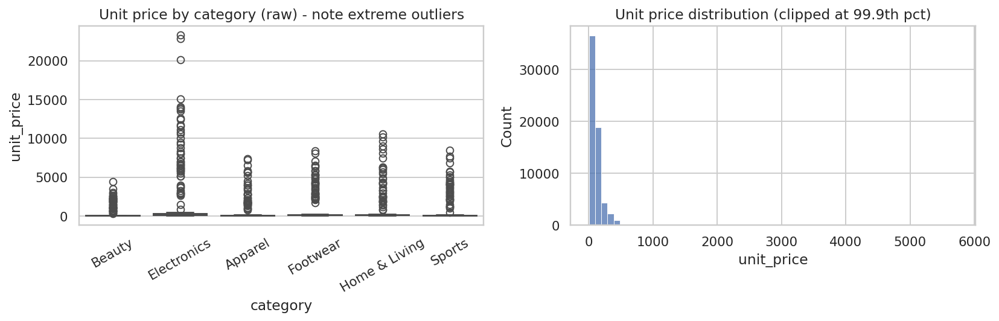
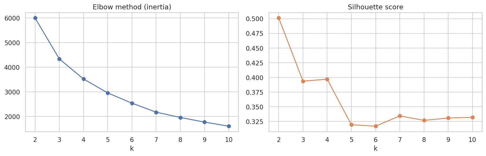
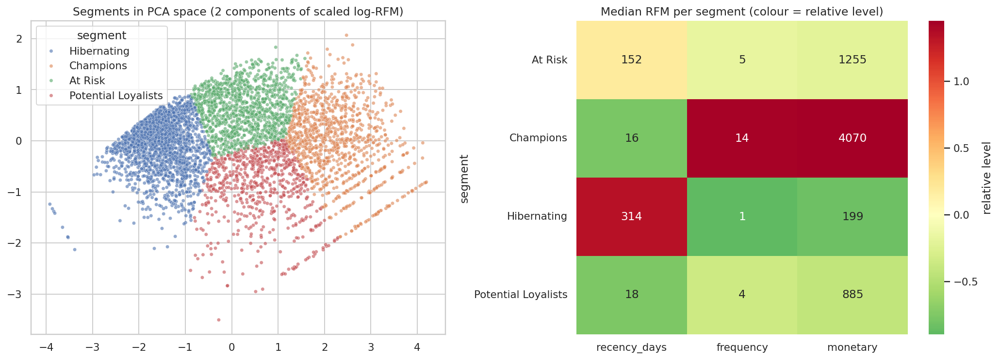
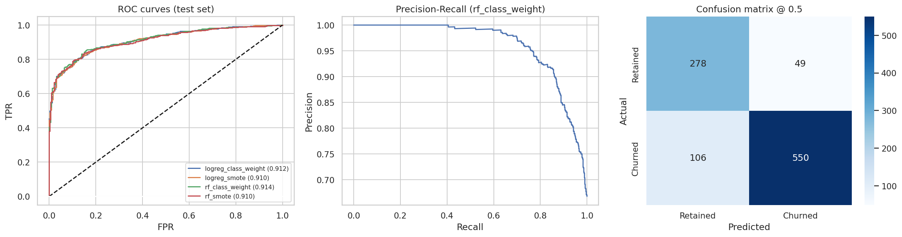
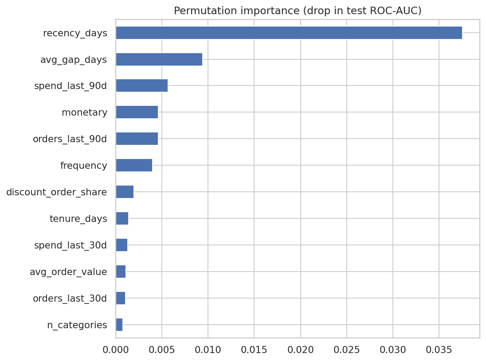
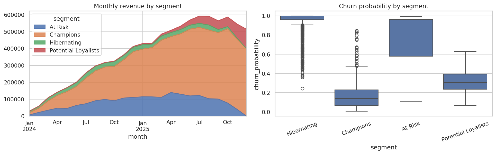

# Customer Segmentation & Churn Prediction - Final Report
*Axlero DA Internship, Project 1 (Retail & E-commerce). Data: synthetic D2C transactions, 5,000 customers, ~64.8k order lines, Jan 2024 - Dec 2025.*

## 1. Business problem
D2C partners overspend on acquisition while retention is unpredictable. We need to (a) know which customers
are valuable, and (b) predict who is about to stop buying so marketing spend can be targeted.

## 2. Headline results
| Objective | Target | Achieved |
|---|---|---|
| Rows dropped during cleaning | < 5 % | 0.50 % |
| Churn ROC-AUC | >= 0.75 | 0.914 (0.797 on active customers) |
| Distinct, actionable segments | >= 4 | 4 |

## 3. Data quality
322 exact duplicates were removed; 1,290 missing prices (median per category), 967 missing quantities (mode = 1) and
1,290 missing channels (`unknown`) were imputed; 648 extreme prices were capped at the category 99th percentile;
returns (negative quantity) were flagged and excluded from revenue. Nothing else was deleted.

## 4. Customer segments (RFM + K-Means, k = 4)

| Segment | Customers | % revenue | Median recency (d) | Median orders | Recommended action |
|---|---|---|---|---|---|
| Champions | 1,051 (21 %) | 65 % | 16 | 14 | Reward and retain: VIP access, loyalty tiers, referrals - **no discounts** |
| At Risk | 1,126 (23 %) | 21 % | 152 | 5 | Win back: personalised "we miss you" offers timed to each customer's usual purchase gap |
| Potential Loyalists | 708 (14 %) | 9 % | 18 | 4 | Build the habit: second/third-purchase journeys, reorder incentives |
| Hibernating | 2,028 (41 %) | 6 % | 315 | 1 | Cheap automated reactivation only; suppress from paid media if unresponsive |

**Insight:** 21 % of customers generate 65 % of revenue. The *At Risk* group is the largest recoverable pool: formerly
valuable (median lifetime spend ~1,255) but already 5 months silent.

## 5. Churn prediction
*Definition:* features use orders before 2025-10-31; **churned = no order in the next 60 days**. This avoids
target leakage (the label is never computed from the same window as the Recency feature).

| Model | CV ROC-AUC | Test precision | Test recall | Test F1 | Test ROC-AUC |
|---|---|---|---|---|---|
| **Random Forest + class weights** | 0.913 | 0.918 | 0.838 | 0.877 | 0.914 |
| Logistic Regression + class weights | 0.913 | 0.923 | 0.808 | 0.862 | 0.912 |
| Logistic Regression + SMOTE | 0.912 | 0.922 | 0.814 | 0.865 | 0.910 |
| Random Forest + SMOTE | 0.912 | 0.904 | 0.848 | 0.875 | 0.910 |

**Caveats we report openly**
* The headline AUC is flattered by customers who lapsed long ago. Restricted to customers active in the last 180
  days the AUC is **0.797** - still above target and the more honest number for retention work.
* Silence relative to a customer's own purchase rhythm (recency, average gap) is the dominant driver.
* Data is simulated; real-world performance must be re-validated on client data.

**Threshold:** 0.5 balances precision/recall (0.92 / 0.84). If a missed churner costs more than a wasted offer,
lower it to 0.3-0.4 (recall 0.87-0.91, precision 0.84-0.89). See `figures/12_threshold_tradeoff.png`.

## 6. Operational output
The live base was scored as of 2026-01-01 (models applied, not refitted). **639 still-recent customers (last order
<= 180 days ago) are High risk (p >= 0.6)**, with an estimated 492k revenue at risk. They are listed in
`data/processed/high_risk_churn_list.csv`, ranked by revenue at risk, and shown in the dashboard.

## 7. Recommendations
1. Protect **Champions**: loyalty benefits instead of discounts (they already buy at full price).
2. Run a time-boxed win-back on the **At Risk** high-probability list first - highest return per rupee.
3. Convert **Potential Loyalists** with a second-purchase journey before the 60-day silence mark.
4. Move **Hibernating** to low-cost automation; stop paid retargeting after two non-responses.
5. Refresh scores weekly and re-validate the model monthly; A/B test the win-back offer to measure true uplift.

